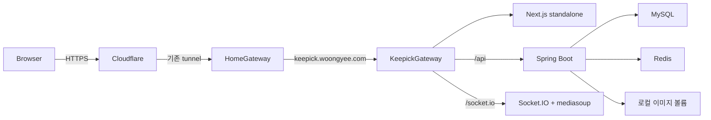

# Keepick 홈서버 공개 데모

프론트엔드·Spring API·mediasoup 시그널링을 같은 HTTPS origin으로 운영한다.
Android는 이 배포에 포함하지 않는다.

## 요청 경로



Cloudflare tunnel은 HTTP와 WebSocket을 전달한다. 공유기 포트 전달과 Windows 미디어
인바운드 규칙은 기본 배포에 포함하지 않는다. mediasoup 미디어 포트는 Docker 내부에만
남겨 둔다. 따라서 이 구성만으로 외부 브라우저 영상통화가 된다고 간주하지 않는다.
웹·로그인·소켓 배포를 먼저 검증하고, 공개 미디어 경로는 별도 연결 실험으로 검증한다.

검토 후보는 홈서버 coturn + Tailscale Funnel TLS 중계다. 브라우저에서 TURN over TLS로
들어와 홈서버 내부 mediasoup에 도달하는 구성이지만, 아직 동작·대역폭을 검증하지 않았다.
Funnel은 TLS TCP 전달을 지원하며 비설정형 대역폭 제한이 있다. 단순히 외부 TURN 주소만
추가하면 사설망 SFU에 도달한다고 가정하지 않는다.

참고: [Cloudflare 프로토콜](https://developers.cloudflare.com/cloudflare-one/networks/connectors/cloudflare-tunnel/routing-to-tunnel/protocols/),
[Tailscale Funnel](https://tailscale.com/docs/features/tailscale-funnel).

Google OAuth callback:
`https://keepick.woongyee.com/api/login/oauth2/code/google`

## 데이터와 권한

- MySQL·Redis·이미지는 Keepick 전용 named volume으로 유지한다. S3는 사용하지 않는다.
- 기존 Mac의 회원·사진은 자동으로 이전하지 않는다. 초기 홈서버 DB는 새로 생성한다.
- DB·Redis·API·Node HTTP 포트는 호스트에 공개하지 않는다.
- 공개 통화 서버는 Spring에서 토큰과 ACCEPTED 그룹 가입 상태를 확인한다.
- Google·DB·JWT 비밀값은 홈서버 `/home/ys050/workspace/keepick/shared/runtime.env`에만 둔다.
- 현재 `local` profile을 파일 저장과 AWS 비활성화에 재사용하고 `homeserver` profile로
  DB 주소·서버 바인딩·forwarded headers를 덮어쓴다. 웹의 `LOCAL_DEMO`는 로컬 저장을
  지원하는 데모 UI 설정이다. Python 얼굴 식별 작업자는 이 배포에 포함하지 않는다.

## CI/CD

`.github/workflows/keepick.yml`:

1. PR은 웹 AI·소켓 테스트, TypeScript, Next 빌드, Spring 전체 테스트,
   native mediasoup 회귀 테스트, 배포기 롤백 테스트를 실행한다.
2. 개인 저장소의 trusted push는 web/api/realtime/gateway amd64 이미지를 GHCR에 빌드한다.
3. `master` push에서만 공개 배포한다. SHA가 붙은 이미지의 digest를 아티팩트로 전달한다.
4. GitHub-hosted runner가 Keepick 전용 MCP로 배포한다. 홈서버 runner는 설치하지 않는다.
5. 배포기는 현재 master SHA와 이미지 revision label을 확인하고 digest로 pull한다.
6. Compose health가 통과하면 성공 처리하고, 실패하면 이전 release로 돌아간다.

GitHub variables:
`KEEPICK_PUBLIC_ORIGIN`, `KEEPICK_DEPLOY_MCP_URL`.
Secret: `KEEPICK_DEPLOY_TOKEN` (Keepick 전용, 기존 SeedOps 관리자 토큰과 별개).
GHCR 인증은 해당 Actions job의 만료되는 `GITHUB_TOKEN`을 사용한다.

## 홈서버 운영

- 공개 URL: `https://keepick.woongyee.com`
- 배포 MCP: `https://ops.woongyee.com/keepick/mcp`
- 상태: MCP `deploy_status` 또는 홈서버에서 `docker compose ps`.
- release: `/home/ys050/workspace/keepick/releases/<40자리 SHA>`
- 현재 release: `/home/ys050/workspace/keepick/current` symlink
- 배포기 bootstrap: `/home/ys050/workspace/keepick-bootstrap`
- DB/사진 보존: `keepick-mysql-data`, `keepick-redis-data`, `keepick-images`

수동 로그:

```sh
cd /home/ys050/workspace/keepick/current
docker compose --env-file .env -f compose.homeserver.yml logs --tail=100 api realtime web gateway
```

수동 앱 롤백은 원하는 이전 release 디렉터리에서 같은 Compose 명령의
`up -d --no-build --wait`로 실행한다. 영속 볼륨은 삭제하지 않는다.
새 스키마 변경은 별도 마이그레이션·백업 설계 후 적용해야 한다. 현재 자동 롤백은
이미지와 실행 설정에 대한 롤백이며 DB 변경을 되돌리지 않는다.

기존 SeedOps `keepick-deployer` 항목은 전용 MCP를 bootstrap한다. SeedOps local mode는
소스 sync를 건너뛰므로 전용 MCP를 업데이트할 때 정확한 소스를 먼저 동기화해야 한다.
전용 MCP 자체는 Docker socket을 사용하므로 관리자 권한을 가진 운영 서비스로 취급한다.

Windows Docker Desktop과 WSL이 다시 시작된 뒤에는 Docker bind mount의 유효성 및
컨테이너 상태를 확인한다. Docker Desktop 자동 시작·WSL·Tailscale·공유기 DHCP 예약은
호스트 운영 설정이다. 앱 restart policy만으로 전원 꺼짐을 복구할 수는 없다.

## 공개 검증 체크

홈페이지·health·Google callback·로그인 후 그룹 생성과 사진 저장·인증된 소켓 연결을
확인한다. 외부 네트워크 두 클라이언트에서 영상·음성·화면 공유 중지·AI 반응을
확인한 후 공개 영상통화 검증 완료로 기록한다. HTTP health 성공만으로 영상 전송을
검증했다고 간주하지 않는다.
