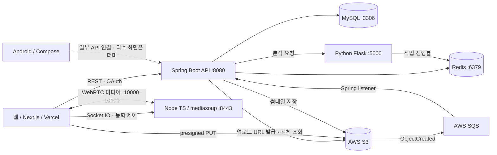

# Keepick 웹·Android 안정화 및 전달 계획

확인일: 2026-10-29, Asia/Seoul. 대상: `wooongyee/Keepick`.

## 1. 이번 범위와 완료 상태

우선 목표는 웹과 Android가 같은 서버·계정·사진 데이터를 사용하며 실제 동작하는 것이다. 꿈틀, KMP/iOS 전환, 신규 AI 기능, 대규모 리팩토링은 보류한다. 기존 Python 사진 분석과 Node 통화 서버는 복구 대상 구성요소로 조사하되, 기본 사진 공유 흐름을 먼저 완성한다.

- 기준: GitHub 통합본 `c8f45d4bf0c36441ad5abead89efb71256e60022`.
- 작업 브랜치: `restore/local-runtime`.
- Android 원본: `archive/ssafy-android`, `ad77147877c3767963db9ba35ff0fc035b5b65a0`.
- 원본 브랜치 전체를 merge하지 않고 `android/`만 복원했다. 옛 브랜치의 웹·서버 내용으로 현재 통합본을 덮어쓰지 않았다.
- 통합 커밋: `6b0f073`, `chore(android): 보존된 앱 소스를 복구 브랜치에 통합`.
- Android 트리 해시가 원본과 통합 커밋 모두 `190db03d596c5bb9217b43cba23ba32f884d8f32`로 일치한다. 198개 파일 추가이며 원래 있던 `.gitignore`를 포함한 전체 Android 트리는 동일하다.
- 옛 Android 작성자·커밋 이력은 개인 포크의 보존 브랜치에 남아 있다. 통합 커밋 본문에 원본 SHA를 기록했다.
- 이번 통합 커밋은 로컬에만 있다. 원격 복구 브랜치 push, PR 생성, CI 설정 활성화, 운영 배포는 하지 않았다.

이전에 추가한 루트 `.gitignore`와 Spring 진입 클래스는 아직 별도 미커밋 변경이다. Android 가져오기 커밋에 섞지 않았다. Spring 진입 클래스는 임시 최소 복구본이므로 원래 backend 브랜치의 `@EnableJpaAuditing`까지 대조해서 별도 복구해야 한다.

## 2. 실제 검사 결과

| 검사 | 결과 | 해석 |
| --- | --- | --- |
| 통합 Android `:app:assembleDebug` | 성공 | JDK 17, SDK 35, Gradle 8.13. 실제 키 대신 점검용 placeholder 사용 |
| Android `:app:testDebugUnitTest` | 성공: 1개 | `addition_isCorrect` 예제뿐이다. 로그인·갤러리 회귀 검증은 없다 |
| Android `:app:lintDebug` | 성공 | Error 0, Warning 79, Hint 3. ktlint 실행 결과와는 별개 |
| Android emulator | 원본 점검 worktree에서 실행 확인 | 홈·그룹·더미 그룹챗 진입. 통합본은 원본과 같은 소스이며 이번에는 빌드 검사 수행 |
| 웹 `tsc --noEmit --incremental false` | 성공 | 서비스 연결·프로덕션 빌드 성공을 의미하지 않음 |
| 웹 ESLint, `.next/**`와 `next-env.d.ts` 제외 | 실패: Error 103, Warning 290 | `no-explicit-any`, hooks 규칙, 서버 JS의 require 규칙 등. 생성 파일 포함 시 나온 과장된 수치는 사용하지 않음 |
| Spring `compileTestJava` | 성공 | JDK 21, 임시 진입 클래스가 있는 작업 트리 기준. 테스트 실행은 아님 |
| Spring `bootJar -x test` | 이전 조사에서 성공 | DB·Redis·AWS 연결 및 서버 기동 미검증 |
| Node / Python | 소스·설정 조사 | 빌드·기동·실제 미디어/분석은 미검증 |

Android에는 인증 SDK·JWT 저장·사진 API 일부가 있지만, 시작 화면은 로그인 상태 계산을 사용하지 않고 Main으로 고정한다. 홈·그룹·앨범·그룹챗에는 더미 데이터가 많다. 화면이 보이는 상태와 실제 기능 연결 상태를 구분한다.

`frontend/next.config.ts`는 `eslint.ignoreDuringBuilds: true`다. 현재 `next build`만 성공시켜서는 린트 통과를 보장할 수 없다. 이번 조사에서 새 프로덕션 웹 빌드는 실행하지 않았다.

## 3. 현재 서버 구조 — 코드 기준

홈서버는 사용자 요청에 따라 이번에는 접속하지 않았다. 아래는 저장소와 앞선 배포 조회에 근거한 구조이며, 현재 홈서버의 실행 컨테이너 목록이 아니다.



| 구성요소 | 현재 역할과 의존성 | 복구 시 확인할 부분 |
| --- | --- | --- |
| `frontend/` | Next 15.4.4, React 19, TS. Vercel에 웹 배포 | API/Socket URL이 공개 번들에 옛 `i13d207.p.ssafy.io`로 남음. 새 환경 변수로 재빌드 필요 |
| `backend/` | Spring Boot 3.5.4, Java 21. 회원·그룹·사진·앨범·JWT·소셜 로그인 | 일반 API의 주체다. DB/Redis/OAuth/AWS 환경 변수, 스키마 초기화와 누락 진입 클래스 복구 필요 |
| MySQL | 회원·그룹·사진·앨범 등 영속 데이터 | `ddl-auto: none`, `exec/sql` DDL/데이터 존재. 기존 데이터 보유 여부와 새 데모 seed 구분 |
| Redis | 이미지 작업 진행률, S3 이벤트 중복 방지 등 | Spring과 Python의 같은 Redis 연결, 재시작 시 작업 상태 복구 정책 확인 |
| S3/SQS | 업로드 서명 URL, 원본·썸네일, 업로드 이벤트 처리 | 설정값만 지워서는 사진 기능이 동작하지 않음. 썸네일과 URL 생성 코드까지 AWS에 연결됨 |
| `image-analysis-server/` | Flask, YOLO/InsightFace 등 사진 분석, 기본 포트 5000 | Redis host가 `redis`로 고정. Flask debug 모드, 모델·CPU/GPU·의존성 및 입력 파일 접근 확인 |
| `livechat-server/` | Node/Express/Socket.IO/mediasoup. 통화 제어·채팅·미디어 | 제어 포트 8443, 미디어 포트 10000–10100, announced IP `192.168.0.7` 고정 |

Node의 채팅방/메시지는 현재 메모리 `Map`에 저장한다. 재시작하면 유지되는 채팅 기록으로 볼 수 없다. Socket 연결부에는 Spring JWT와 그룹 권한을 검증하는 흐름이 확인되지 않았다. 방 입장·메시지·미디어 권한 연결은 공개 서비스 복구 항목이다.

사진 업로드와 분석은 한 이벤트 체인이 아니다. S3 업로드 이벤트는 SQS를 통해 썸네일 생성을 시작한다. 유사 사진 등의 분석은 별도 Spring 서비스가 Python HTTP API를 호출하고 Redis에 진행 상태를 기록한다.

통합 실행용 루트 Compose, Spring API Dockerfile, 전체 서비스 healthcheck/readiness 구성은 없다. 포팅 문서의 예시는 현재 저장소에서 바로 실행 가능한 배포 구성과 구분한다.

### 인증과 현재 Vercel 상태

- 웹: Spring OAuth 진입 `/api/oauth2/authorization/{provider}`, callback `/api/login/oauth2/code/{provider}`. 성공 후 프런트로 JWT를 query에 전달하고 웹이 localStorage에 저장하는 흐름이다.
- Android: Kakao/Naver SDK의 제공자 토큰을 `/api/auth/login`에 보내 앱용 JWT를 받는다. 토큰은 Proto DataStore에 저장한다.
- 웹에는 `/api/auth/refresh` 호출 코드가 있지만 현재 통합 서버에서 대응 refresh 구현을 확인하지 못했다. 예전 refresh 관련 merge 메시지만으로 지원된다고 판단하지 않는다.
- 웹과 앱의 동일 사용자 식별, provider별 이메일 없는 응답, 만료·로그아웃·재로그인 계약을 먼저 정리해야 한다. 앱의 로그인 우회도 실제 인증 흐름으로 바꿔야 한다.
- 개인 소유 OAuth 앱/도메인/Android 서명 키 해시와 redirect URI를 확정한다. 처음에는 양쪽에서 가능한 제공자 하나로 실제 왕복 검증하고 확장한다.
- `https://fe-keepick.vercel.app`은 응답하며 현재 production 메타데이터는 READY다. 마지막 확인된 배포는 2025-08-20 11:05 KST, CLI 배포로 기록돼 있고 Git 커밋 연결은 확인되지 않았다.
- Vercel의 project/deployment 기본 정보는 조회됐지만 연결된 팀 범위의 배포 목록은 403, 환경 변수 메타데이터는 404였다. 현재 환경 변수 값·Git 연결·빌드 설정을 모두 확인했다고 볼 수 없다. 프로젝트 소유권/접근 범위 확인 후 연결을 결정한다.

## 4. 홈서버 복구안 — 아직 미적용

기존 Windows + WSL Ubuntu/Docker 홈서버를 사용한다. 웹은 Vercel, Spring·MySQL·Redis·Node·Python과 사진 파일은 홈서버에 둔다. 현 시점에서 서버 실행 상태·사양·공인망 접근은 미확인이다.

처음 실행할 범위는 Spring + MySQL + Redis + 로컬 사진 볼륨이다. 인증·그룹·사진 저장을 양 클라이언트에서 확인하고 Node/Python을 연결한다. 별도 플랫폼이나 브로커는 초기 복구에 추가하지 않는다.

- S3 대신 홈서버 파일 저장을 선택한다. 기존 업로드 응답 필드와 가능한 한 호환되는 로컬 업로드 URL/완료 처리를 만들고, 완료 시 썸네일·DB 상태를 갱신한다. S3/SQS 빈은 홈서버 프로필에서 비활성화해야 한다. 이는 새 구현이 필요한 설계다.
- 백그라운드 분석이 필요해지는 단계에서 작업 기록·중복 실행·재시도 정책을 붙인다. 이전 설계의 MySQL 작업 테이블은 그 단계의 후보로 두며, 첫 서비스 기동의 선행 조건으로 키우지 않는다.
- 파일 용량·개수 제한, 그룹별 읽기/삭제 권한, DB와 사진 볼륨의 백업·복원을 함께 검증한다. S3 이용료는 없지만 홈서버 디스크·전력·회선은 사용한다.
- API/Socket.IO의 HTTPS/WSS는 기존 Cloudflare Tunnel/nginx 경로에 연결하는 안이다. 기존 서비스와 별도 Compose 프로젝트·네트워크·볼륨을 사용한다. 실제 도메인과 포트는 적용 전에 확정한다.
- WebRTC 미디어는 HTTP 터널 연결만으로 해결되지 않는다. `announcedIp`, 공인 주소/CGNAT, 공유기·Windows·WSL·Docker의 UDP/TCP 전달을 확인해야 한다. 내부망 동작과 외부망 두 기기 통화를 따로 판정한다. 외부 경로가 확보되기 전에는 공개 통화가 복구됐다고 표시하지 않는다.

### 기존 홈서버 MCP 활용

별도 범용 SSH MCP를 새로 만들기보다 기존 `ops`의 SeedOps를 사용한다. 확인된 도구 구현은 `deploy_list`, `deploy_plan`, `deploy_status`, `deploy_logs`, `deploy_apply`다. Codex에는 `https://ops.woongyee.com/mcp`가 설정돼 있지만 실제 도구 호출은 아직 검증되지 않았다.

우선 홈서버 온라인 상태에서 조회 도구부터 확인하고 Keepick을 별도 서비스로 등록한다. `deploy_apply` 이전에 정확한 소스 SHA 또는 이미지 digest가 서버에 전달돼 있어야 한다. 현재 SeedOps local 모드는 소스 동기화를 생략하므로 apply만 호출하면 최신 코드가 배포된다고 보장할 수 없다. 승인된 릴리스의 소스/산출물 전달 → plan 검토 → apply → healthcheck 순서를 사용한다.

## 5. 기존 커밋·MR·CI에서 확인한 점

자료: `docs/commit-convention.md`, `docs/branch-strategy.md`, `docs/pr-template.md`, Git 로그와 `.gitlab-ci.yml`, Android 보존 CI 파일. GitHub 팀 원본과 개인 포크 PR 검색 결과는 비어 있었다. GitLab MR의 토론·리뷰 본문은 확보하지 못했고, Git에 남은 메시지만 확인했다.

- 커밋은 `Feat/Fix/...: 설명 [S13P11D207-번호]`가 주류이며 Android에는 갤러리·상세·그룹챗을 단계별로 구현한 이력이 남아 있다.
- MR 예: `!64`의 `[BE] webrtc 관련 처리 수정`, `!68`의 backend → master 통합. `Fix: resolve conflict`처럼 최종 기능/이유가 드러나지 않는 메시지와 장기 브랜치 간 반복 merge도 존재한다.
- 문서에는 frontend/backend/aos/ai 장기 브랜치와 각종 lint/test/deploy가 계획돼 있다. 실제 루트 CI는 deploy 한 단계다.
- 현재 `.gitlab-ci.yml`은 `master`, `frontend`, `fe/feat/prototype`에서 모두 `vercel ... --prod`를 실행한다. 테스트·lint·Android/API 검사가 없다. GitHub Actions 파일은 없다.
- Android에는 lint/build/test GitLab 설정이 따로 있지만 현재 루트에서 include하지 않는다. 보존 Android 브랜치의 루트 설정도 include가 없고, 정의한 stages에 없는 `stage: deploy`를 참조한다. 파일 존재만으로 Android CI가 작동했다고 볼 수 없다.

## 6. 권장 브랜치·커밋·PR 구조

기본 브랜치 이름은 우선 `master`를 유지한다. 복구 작업은 `restore/local-runtime`에 모으고, 이후 짧은 기능 브랜치가 같은 통합 브랜치를 대상으로 PR을 만든다. 안정화 완료 후 master로 복구 결과를 반영한다. frontend/backend/android별 장기 통합 브랜치를 다시 만들지 않는다.

새 커밋 형식은 `type(scope): 사용자에게 달라지는 동작`으로 단순화한다. `fix`, `feat`, `refactor`, `test`, `ci`, `build`, `docs`, `chore`를 사용하고 scope는 필요할 때 `auth`, `photos`, `web`, `android`, `api`, `media`, `infra`를 붙인다. 이슈가 생기면 GitHub 번호를 본문에 연결한다. 옛 Jira 번호를 새 작업에 계속 강제하거나 과거 커밋을 재작성하지 않는다.

예:

```text
fix(auth): 만료된 세션에서 웹과 앱을 로그인 화면으로 이동
fix(photos): 업로드 완료 후 두 클라이언트에 사진을 표시
ci: 웹과 Android 검사를 PR 필수 조건으로 추가
build(api): 홈서버 프로필에서 AWS 없이 기동하도록 구성
```

한 커밋은 이유 하나로 설명하고 되돌릴 수 있게 한다. 포맷 전체 변경, 의존성 대규모 갱신, 기능 복구를 함께 묶지 않는다. API 계약이 바뀌면 서버·웹·앱의 대응 변경은 같은 PR에서 함께 검증할 수 있다. 독립적으로 검증되는 커밋은 유지하고, 수정 반복/WIP는 merge 전에 정리한다. PR 전체 squash는 커밋의 독립성이 없을 때만 선택한다.

| PR 순서 | 제목/범위 | 완료 증거 |
| --- | --- | --- |
| 1 | `chore(android): 보존된 앱을 웹·서버 통합본에 복원` | 현재 로컬 통합 커밋. 원본 tree 일치, APK/lint 결과, 예제 테스트의 한계 |
| 2 | `build: 웹·앱·API 실행 조건과 CI 기준선 복구` | Spring 원본 진입 클래스, 환경 변수 예시·툴체인, 웹 lint 오류 정리, 깨끗한 checkout 빌드, CI 실제 실행. 커지면 실행 환경과 lint/CI를 분리 |
| 3 | `feat(infra): 홈서버에서 API와 사진 저장소 실행` | Compose/healthcheck/seed/볼륨, AWS 없는 프로필, 재시작 후 데이터와 사진 보존 |
| 4 | `fix(auth): 웹과 Android의 실사용 로그인 복구` | 제공자 하나로 양쪽 로그인/만료/로그아웃/재로그인, 동일 사용자·그룹 식별 |
| 5 | `fix(photos): 양 클라이언트의 사진 공유 흐름 복구` | 더미 데이터 제거 범위를 명시, 그룹/초대/사진 업로드·조회·삭제를 서로 교차 확인. 그룹/초대가 크면 별도 PR |
| 6 | `fix(media): 채팅과 실제 통화 연결 복구` | 그룹 권한, 실패/종료/재연결, 두 기기 실제 음성·영상. 분석은 별도 기능 복구 PR로 분리 |

각 PR 본문은 **문제와 변경 후 동작 → 범위/핵심 결정 → 실행한 검증과 결과 → 남은 제약 → 배포/되돌리기** 순서로 쓴다. 예전 템플릿의 무조건적인 “테스트를 작성했습니다” 체크 대신 실행 명령·결과·미검증 항목을 적는다. UI PR은 스크린샷, 서버 PR은 실제 요청/응답이나 상태 확인을 붙인다. 문서 수정에 불필요한 테스트 작성을 요구하지 않는다.

원본 팀 작업, 본인 기존 기여, 이번 복구 기여를 구분해 기록한다. 복구 이력이 포트폴리오 근거가 되려면 구현한 기능과 실제 검증한 기능의 경계가 보여야 한다.

## 7. CI / 빌드 / 배포 권장안

처음에는 GitHub Actions의 PR CI 하나와 수동 릴리스 경로 하나로 시작한다. CI 서버를 홈서버에 새로 상시 설치할 필요는 없다.

```text
PR → 변경 영역 판단 → 해당 검사/빌드 → ci-required → merge
승인한 merge SHA → 환경별 릴리스 빌드/산출물 기록 → 수동 배포 → 실제 연결 검증
```

### PR 검사

`pull_request`, 통합 브랜치/master push에서 workflow는 항상 실행하고, 내부 job만 변경 영역에 따라 선택한다. 마지막 `ci-required`는 `always()`로 실행해서 실패·취소·필수 작업 미실행을 판정한다. 경로 필터로 workflow 전체를 생략한 필수 체크는 Pending으로 남을 수 있다. API 계약·공통 환경 변경은 웹·앱·API 검사를 함께 실행한다. 문서만 바꾸면 무거운 빌드는 생략한다.

| Job | 툴체인/검사 | 운영 자원 의존성 |
| --- | --- | --- |
| web | Node 22 계열을 명시하고 `npm ci`, 별도 ESLint/tsc, `next build` | 점검 URL/환경 변수 사용. 실제 OAuth 없이 빌드 가능하게 구성. 현재 lint 오류부터 해결 |
| api | Java 21, Gradle wrapper, unit test + `bootJar`; 필요한 통합 테스트만 별도 MySQL/Redis | 기존 Testcontainers 모듈 버전이 1.21.3/1.17.3으로 다름. 정렬 후 실제 실행 확인. H2 통과로 MySQL 동작을 대신하지 않음 |
| android | Java 17, SDK 35, wrapper, `assembleDebug`, `testDebugUnitTest`, `lintDebug` | local.properties는 CI에서 placeholder로 생성. SDK 로그인 성공 여부는 별도 검증. 현재 소스에 NDK 빌드가 없으므로 선행 설치 조건으로 넣지 않음 |
| media | Node 22, lockfile 기반 `npm ci`, TypeScript build, 방 입장/권한·이벤트 검사 추가 | mediasoup native worker를 최종 Linux 대상과 같은 아키텍처에서 확인. tsc 통과는 실제 통화 증거가 아님 |
| analysis | Python 버전/의존성 고정, 작은 입력 fixture와 응답 계약 검사 | 매 PR마다 전체 모델 다운로드·GPU 테스트를 실행하지 않음. 의존성/모델 변경 시 별도 이미지 빌드와 실제 추론 smoke |

기본 회귀 테스트는 인증 만료, 그룹 권한, 업로드 완료/실패·재시도, 사진 조회/삭제에 집중한다. Android emulator와 웹의 실제 API 연결 시나리오는 핵심 기능 변경·릴리스 시 실행한다. 예제 테스트 수를 늘려 품질 지표로 사용하지 않는다.

초기 빌드 산출물은 debug APK와 테스트 리포트, 서버 이미지/버전 manifest다. 캐시는 의존성 다운로드에 사용하고 검증 산출물과 구분한다. 워크플로/설정 변경 시 영향 영역 검사도 실행한다. 최초에는 전체 baseline을 한 번 돌려 각 job이 실제로 성공하는지 확인한 뒤 필수 체크로 등록한다. 실패한 lint를 숨기거나 무조건 continue-on-error로 통과시키지 않는다.

### 배포

- **웹:** Vercel Git 연결과 production branch를 먼저 확인한다. Root Directory는 `frontend`. 기능 브랜치는 preview, 운영은 승인한 통합 커밋만 사용한다. Vercel 자동 배포와 GitHub의 `vercel --prod`를 중복 실행하지 않는다. 접근 가능한 플랜/설정에서 Deployment Checks를 사용할 수 있으면 필수 검사와 연결하고, 미확인 상태에서는 수동 운영 승격을 기본으로 둔다.
- `NEXT_PUBLIC_*`는 웹 빌드에 포함된다. Preview에서 검증한 URL과 운영 API URL이 다르면 환경에 맞는 별도 웹 빌드와 검증이 필요하다. preview를 검증했다는 이유로 운영 환경이 자동 검증된 것으로 보지 않는다.
- **홈서버:** PR CI는 GitHub-hosted runner에서 한다. 공개 포크 PR을 홈서버 Docker 권한으로 실행하지 않는다. 초기 CD는 Mac에서 승인한 SHA/산출물을 SSH로 전달하고 SeedOps plan/apply를 사용하는 수동 경로로 충분하다. GitHub runner가 개인 Tailscale 서버에 바로 접근한다고 가정하지 않는다.
- 서버 이미지는 SHA 태그와 digest, 플랫폼을 기록한다. 테스트한 이미지 자체를 배포하고 홈서버에서 별도 최신 소스를 다시 빌드해 섞지 않는다. 실제 홈서버 CPU 아키텍처 확인이 선행한다. Python 모델 버전도 manifest에 남긴다.
- DB/파일 볼륨은 앱 재배포 시 보존한다. 스키마 변경은 이전 웹/APK가 잠시 함께 동작할 수 있게 추가 후 전환 방식으로 진행한다. DB 변경이 있으면 이미지 rollback만으로 복구되지 않으므로 백업과 복원 범위도 적는다.
- **Android:** 처음에는 CI debug APK artifact로 설치·점검한다. 운영 OAuth 키/서명 키와 release APK/AAB는 보호된 수동 릴리스에서 사용한다. Play Store 배포와 서명 체계 변경은 현재 안정화의 선행 조건이 아니다.

초기 운영 배포 기준은 로그인 → 그룹 참가 → 사진 업로드 → 반대쪽 클라이언트 조회 → 삭제 → 서버/앱 재시작 후 상태 확인이다. 만료 세션과 실패한 업로드에서도 다시 진행할 수 있어야 한다. 통화와 분석은 각각 별도 완료 기준을 충족한 뒤 사용 가능 상태로 표시한다.

## 8. 바로 다음 실행 단위

설계 확인 후 PR 2의 실행 조건/CI 기준선부터 진행한다. 이후 로컬 Compose로 API와 스토리지 흐름을 검증한 다음 홈서버를 켜서 이전한다. OAuth 제공자 설정·Vercel 운영 연결·DNS/홈서버 배포는 실제 설정안을 준비한 뒤 사용자와 적용 시점을 정한다.

## 근거 링크

- [개인 포크](https://github.com/wooongyee/Keepick), [보존 Android 브랜치](https://github.com/wooongyee/Keepick/tree/archive/ssafy-android/android)
- 저장소: `.gitlab-ci.yml`, `android/.gitlab-ci-android.yml`, `docs/branch-strategy.md`, `docs/commit-convention.md`, `docs/pr-template.md`
- 서버: `backend/src/main/resources/application.yml`, `external/s3/*`, `photo/application/PhotoAnalysisService.java`, `livechat-server/src/config/mediasoup.config.ts`, `livechat-server/src/infra/socket/*`, `livechat-server/src/domain/chat/repository/chat.repository.ts`, `image-analysis-server/app.py`, `image-analysis-server/redis_client.py`
- [GitHub required checks와 skip 동작](https://docs.github.com/en/pull-requests/how-tos/merge-and-close-pull-requests/troubleshooting-required-status-checks)
- [GitHub self-hosted runner 실행 경계](https://docs.github.com/en/actions/reference/security/secure-use)
- [Vercel Git 및 production branch](https://vercel.com/docs/git), [Vercel Deployment Checks](https://vercel.com/docs/deployment-checks)
